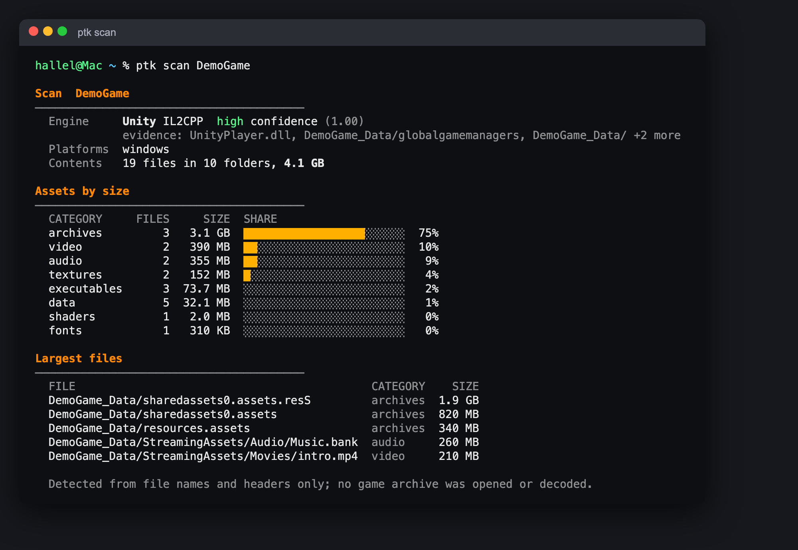
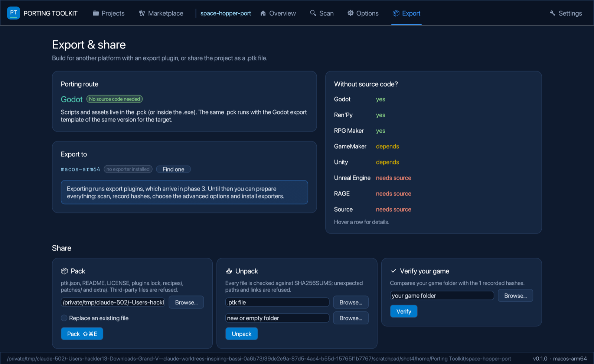
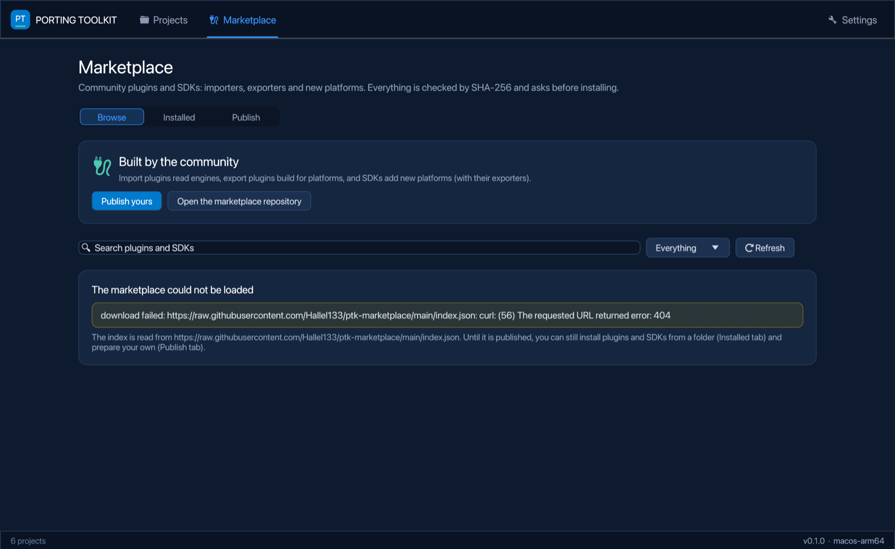
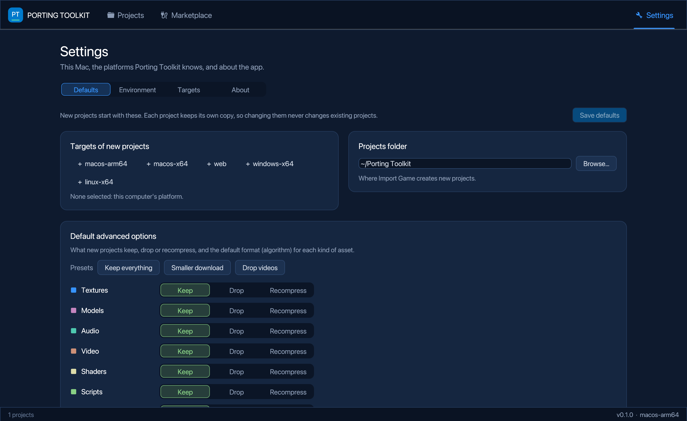

# Porting Toolkit

```
██████      ████    ██████    ██████████  ██████  ██      ██    ██████
██░░░░██  ██ ░░░██  ██░░░░██   ░░░██░░░░░  ░██░░░ ████    ██░ ██ ░░░░░░
██████ ░░ ██░   ██░ ██████ ░░     ██░       ██░   ██░░██  ██░ ██░ ████
██░░░░░   ██░   ██░ ██░░██░       ██░       ██░   ██░  ░████░ ██░  ░██░
██░        ░████ ░░ ██░  ░██      ██░     ██████  ██░    ░██░  ░██████░
 ░░          ░░░░    ░░    ░░      ░░      ░░░░░░  ░░      ░░    ░░░░░░
██████████    ████      ████    ██        ██    ██  ██████  ██████████
 ░░░██░░░░░ ██ ░░░██  ██ ░░░██  ██░       ██░ ██ ░░  ░██░░░  ░░░██░░░░░
    ██░     ██░   ██░ ██░   ██░ ██░       ████ ░░     ██░       ██░
    ██░     ██░   ██░ ██░   ██░ ██░       ██░░██      ██░       ██░
    ██░      ░████ ░░  ░████ ░░ ████████  ██░  ░██  ██████      ██░
     ░░        ░░░░      ░░░░    ░░░░░░░░  ░░    ░░  ░░░░░░      ░░
```

A community tool to manage, convert, export and import game projects between
platforms. macOS first; Windows and Linux later.

**Bring your own game.** Porting Toolkit works on game files you own. Community
project files (`.ptk`) share recipes, settings, community-written patches and
SHA-256 hashes, never original game files or decompiled game code. See
[docs/legal.md](docs/legal.md).



> Status: **phase 3** (CLI + desktop GUI + plugins). Built-in plugins port
> **Godot**, **Ren'Py**, **LÖVE**, **RPG Maker** (MV/MZ, and XP/VX/VX Ace with
> mkxp-z) and **HTML5** games (Construct, GDevelop, Twine, NW.js, Electron...)
> to **macOS**, **Windows**, **Linux** and the **web**, without source code.
> Other engines need community plugins.

## Install from source (macOS)

You need the Xcode Command Line Tools, [rustup](https://rustup.rs) and
[uv](https://docs.astral.sh/uv/).

```bash
git clone https://github.com/Hallel133/Porting-Toolkit.git
cd Porting-Toolkit
cargo build --release
./target/release/ptk doctor     # checks tools, sets up the Python engine
```

`ptk doctor` creates a managed Python environment for the engine in
`~/Library/Application Support/PortingToolkit/`.

## Quick start

```bash
ptk                                   # banner + help
ptk init my-port --title "My Game"    # new project folder
ptk scan ~/Games/MyGame --record my-port
ptk options set textures --action recompress --quality 80 --max-resolution 2048 -p my-port
ptk info my-port                      # game, targets, advanced options
ptk pack my-port                      # -> my-port-0.1.0.ptk (no game files inside)
```

Someone else continues the port with their own copy of the game:

```bash
ptk unpack my-port-0.1.0.ptk
ptk verify ~/Games/MyGame -p my-port  # is this the same game version?
```

## Desktop app

`ptk-gui` is a project manager in the spirit of game-engine launchers: a
**Projects** list (favorites, filter, sort, an action column with Open,
Export, Scan, Verify, Show in Finder, Remove), a **Marketplace** (Browse,
Installed, Publish) and **Settings** (environment check, targets, about).
Opening a project adds its tabs: **Game** (title, targets, icon and poster,
and the advanced options, all on one page), Scan and Export. **Settings →
Defaults** holds what new projects start with: targets, advanced options and
the default format (algorithm) per asset type. On macOS
it has a real menu bar with the usual shortcuts (⌘N, ⌘I import, ⌘O, ⌘S,
⌘1–⌘5, ⌘, settings). Drop a game, a project or a `.ptk` on the window.

```bash
cargo run --release -p ptk-gui
```


| | |
|---|---|
|  |  |
|  |  |

## Import a game (no source code)

```bash
ptk import "Space Hopper.exe"        # or a folder, .app, .zip, .deb, .dmg
```

Porting Toolkit reads names and headers (it even finds a Godot `.pck` inside
an `.exe`), records SHA-256 hashes and creates a project. Archives are
unpacked into your data folder; game files never go into the project.

**Can it be ported without source code?** It depends on where the game's
logic lives:

| Engine | Without source code |
|---|---|
| Godot, Ren'Py, LÖVE, RPG Maker, HTML5 engines | Yes: the game data is portable; pair it with the engine runtime for the target |
| Unity, GameMaker | Depends: Unity Mono yes, IL2CPP no; GameMaker needs a runner for the target |
| Unreal, RAGE, Source | No: native code. Needs the source, or a compatibility layer (Wine-style) |

## Export to macOS, Windows, Linux and the web

```bash
ptk export -p space-hopper-port                 # every target of the project
ptk export -p space-hopper-port -t web --open   # one target
ptk serve space-hopper-port/build/web --open    # play the web build locally
```

Builds go to `PROJECT/build/<target>/` (`-o` changes it). In the app:
**Export → Export all**, then **Open**, **Play in browser** or **Show in Finder**.

| Plugin (built in) | Reads | macOS | Windows / Linux | Web |
|---|---|---|---|---|
| Godot | `.pck`, standalone or inside the `.exe` / `.app` (Godot 3 and 4) | `.app` from the official template of the same Godot version, thinned and ad-hoc signed | `<Title>.exe` / `<Title>.x86_64` + `<Title>.pck` from the official template, the game's native libraries, and a zip | `index.html` + `.wasm` + `.pck` (single-threaded, any static host) |
| HTML5 | RPG Maker MV/MZ, Construct, GDevelop, Twine, Phaser, NW.js (`package.nw`), Electron (`app.asar`) | `.app` with a small WebKit wrapper (needs the Xcode command line tools) | the game with the NW.js runtime (pinned, SHA-256 checked), and a zip | the game's web root |
| Ren'Py | the game folder (also inside a Mac `.app`): version, platforms it has, `.rpa` archives (listed, never extracted) | `.app` with the game in `Contents/Resources/autorun` | `<name>.exe` / `<name>.sh` with Ren'Py's platform files | – |
| LÖVE | `.love`, a fused `.exe`, a Mac app or a source folder; `conf.lua` (never run) | the LÖVE 11.5 app with `game.love` inside | fused `.exe` / the LÖVE AppImage + `game.love` | – |
| RPG Maker XP/VX/VX Ace | `Game.ini` and the archive header (never decrypted) | mkxp-z's app with the game in `Contents/Game` | Windows: the original game; Linux: mkxp-z + the game | – |

Godot templates come from the Godot editor's folder when installed;
otherwise only the needed files (about 10 MB for the web, 120 MB for macOS)
are fetched from Godot's GitHub release, not the whole 1.3 GB archive.
`--set templates=PATH` uses your own. Windows and Linux builds can be made
on a Mac; the `.exe` keeps the engine's icon and is not signed, so Windows
SmartScreen may ask once. Encrypted `.pck` files and C# (.NET)
Godot games are refused with an explanation. Ad-hoc signed apps run on your
Mac; to give them to others, sign and notarize them with your Apple
Developer ID. See [docs/plugins.md](docs/plugins.md).

### Android (experimental)

```bash
ptk export -p space-hopper-port -t android      # → build/android/<Title>.apk
adb install -r "space-hopper-port/build/android/Space Hopper.apk"
```

Godot 4 games get Godot's own `android_release.apk` template with the game's
files, the way Godot's exporter does it without Gradle. HTML5 games (RPG Maker
MV/MZ, Construct, Twine...) play in a small WebView player that Porting
Toolkit builds once on your computer. Both need the Android SDK
(`brew install --cask android-commandlinetools`, then
`sdkmanager "build-tools;35.0.0" "platforms;android-35"`) and a JDK
(`brew install openjdk`); `ptk tools` shows what is missing. APKs are signed
with a debug key made on your computer (for testing); `--set keystore=...`
uses your own key, `--set orientation=portrait`, `--set permissions=INTERNET`
and `--set package=com.you.game` change the app. Desktop Godot games only have
desktop texture formats; Godot 4.2+ decodes them on phones (with a warning:
more memory), older versions are refused.

## Advanced options: compression algorithms

The advanced options are applied to the exported copy (never to your game).
For each category set to **Recompress**, every image, sound and video the
engine can load is re-encoded with the chosen format, or with **Automatic**:

| Engine | What Automatic does |
|---|---|
| HTML5, RPG Maker, LÖVE, RGSS | keeps each file's format and name (the game loads files by name), only smaller: PNG (lossless, or lossy with pngquant), JPEG, WebP, Ogg Vorbis/Opus, AAC, MP3, H.264/HEVC/VP9/AV1 |
| Ren'Py | the target's preferred codec where the file allows it (for example Opus in `.ogg`) |
| Godot | nothing yet: imported resources inside the `.pck` are kept |

Every result is checked: at least 3% smaller, same image size and
transparency, same length and channels, and the same `LOOPSTART`/`LOOPLENGTH`
tags (RPG Maker loops music with them). RPG Maker MZ keeps `.ogg` as Vorbis,
because it decodes it itself. Anything that fails a check keeps its original
bytes. Results are cached by content, so the next export is instant.

```bash
ptk assets -p space-hopper-port -t web    # estimate the savings (builds nothing)
ptk export -p space-hopper-port --assets off   # export without the options
ptk tools                                  # FFmpeg, cwebp, oxipng, pngquant, oggenc ...
ptk tools install oxipng                   # pinned release, checked against its SHA-256
```

Tools come from your system first (Homebrew: `brew install ffmpeg webp
pngquant vorbis-tools`), then from a pinned download. PNG always works: a
built-in re-deflate keeps the pixels and needs no tool. In the app: **Export →
Estimate savings**, and the Builds card shows the sizes before and after.

## Marketplace and SDKs

**Game ports** (ready-made porting projects with a poster), plugins and SDKs
(new platforms + their exporters) are listed in a
JSON index on GitHub. `ptk market list|install`, `ptk sdk new|validate|install`
and `ptk publish <folder>` (zip + SHA-256 + index entry for a pull request).
See [docs/marketplace.md](docs/marketplace.md).

## Commands

| Command | What it does |
|---|---|
| `ptk`, `ptk about` | Banner, help, version, roadmap |
| `ptk init <dir>` | New project: `ptk.json`, `recipes/`, `patches/`, `plugins.lock` |
| `ptk info [project]` | Project, `ptk.json` or `.ptk`: game, targets, advanced options |
| `ptk options [set …]` | Keep / drop / recompress, quality, max resolution per asset category |
| `ptk targets` | Platforms (web, macos-arm64, macos-x64, windows-x64, linux-x64, + SDK targets) |
| `ptk doctor` | Checks Xcode CLT, clang, rustup, uv and the compression tools; sets up the engine |
| `ptk scan <game-dir>` | Engine and contents from file names only (`--json`, `--record`) |
| `ptk pack` / `ptk unpack` | Create / check-and-extract a `.ptk` community project file |
| `ptk verify <game-dir>` | Compare your game files with a project's recorded hashes |
| `ptk plugin list\|new\|validate\|install` | Import/export plugins (built-in and installed) |
| `ptk import <build>` | Project from a folder, .app, .exe, .zip, .deb or .dmg (runs the import plugin) |
| `ptk export [-t ID]` | Build for macOS, Windows, Linux or the web with export plugins (`--set key=value`, `--assets apply\|plan\|off`) |
| `ptk assets [-t ID]` | Estimate what the advanced options save, per target |
| `ptk tools [list\|install ID]` | Compression tools: where each one is, or install a pinned build |
| `ptk art --icon\|--poster <image>` | The port's icon and poster (shared in the `.ptk`, used by exports) |
| `ptk serve <dir>` | Serve a web build on this computer, with the headers WebAssembly needs |
| `ptk sdk new\|validate\|install` | SDKs: new platforms and their exporters |
| `ptk market list\|install` | Community marketplace |
| `ptk publish <path>` | Package a plugin, SDK or .ptk for the marketplace |

`ptk scan` recognises Unity, Unreal, Godot, RAGE, Source, GameMaker, Ren'Py,
LÖVE, RPG Maker (MV/MZ and XP/VX/VX Ace), HTML5 games (Construct 2/3,
GDevelop, Phaser, Cocos, Defold, Twine, NW.js, Electron) and macOS `.app` /
Mach-O, from names and executable headers only (Twine stories by the
`<tw-storydata>` tag of their page). It never opens or decodes game archives.

Colors are off when output is not a terminal, with `NO_COLOR=1` or `--no-color`.

## Roadmap

1. macOS + CLI infrastructure + banner + file structure (done)
2. Desktop GUI (egui) (done)
3. **Import/export plugins** (now: Godot, Ren'Py, LÖVE, RPG Maker and HTML5 to macOS, Windows, Linux, the web and Android (experimental), with applied compression options), then re-encoding Godot's imported textures
4. Windows/Linux and the full community marketplace

## Documentation

- [ARCHITECTURE.md](ARCHITECTURE.md): Rust app + Python engine, JSON-RPC protocol
- [docs/project-format.md](docs/project-format.md): `ptk.json` and `.ptk` files
- [docs/plugins.md](docs/plugins.md): plugin format, API, built-in plugins and security model
- [docs/marketplace.md](docs/marketplace.md): marketplace, SDKs and publishing
- [docs/legal.md](docs/legal.md): why the toolkit never distributes games

## Development

```bash
cargo test --workspace                # Rust (also starts the Python engine)
(cd engine && uv run pytest)          # Python engine
cargo fmt --all --check && cargo clippy --workspace --all-targets -- -D warnings
```

## License

MIT. See [LICENSE](LICENSE).

---

<div dir="rtl">

## עברית

**Porting Toolkit** הוא כלי קהילתי לניהול, המרה, ייצוא וייבוא של פרויקטי משחקים בין פלטפורמות. קודם macOS, ואחר כך Windows ו-Linux.

**מביאים את המשחק שלכם.** הכלי עובד על קבצי משחק שבבעלותכם. קובצי פרויקט קהילתיים (`.ptk`) משתפים מתכונים, הגדרות, תיקונים שהקהילה כתבה וטביעות SHA-256 בלבד, **אף פעם** לא קבצי משחק מקוריים או קוד משחק מפורק. הפקודה `ptk pack` מסרבת לארוז קבצים של צד שלישי, ו-`ptk verify` בודקת שהעותק שלכם תואם לגרסה שהפרויקט נבנה עבורה.

### התקנה (macOS)

צריך Xcode Command Line Tools,‏ rustup ו-uv. אחרי `cargo build --release` מריצים `ptk doctor`, שבודק את הכלים ומקים סביבת Python מנוהלת למנוע בתיקייה `~/Library/Application Support/PortingToolkit/`.

### שימוש בסיסי

- `ptk init my-port` יוצר פרויקט חדש.
- `ptk scan <תיקיית משחק> --record my-port` מזהה את המנוע (Unity,‏ Unreal,‏ Godot,‏ RAGE,‏ Source,‏ GameMaker,‏ Ren'Py,‏ RPG Maker,‏ macOS) לפי שמות קבצים בלבד, ושומר טביעות.
- `ptk options set textures --action recompress --quality 80` קובע מה נשמר, נמחק או נדחס מחדש לפני ההמרה.
- `ptk pack` / `ptk unpack` / `ptk verify` לשיתוף פרויקטים.
- `ptk plugin new|validate|install|list` לתוספי ייבוא/ייצוא (ב-Python, עם הצהרת הרשאות).
- `ptk export -p my-port` בונה את המשחק ל-macOS ולווב, ו-`ptk serve` מגיש build של ווב במחשב שלכם.

### אפליקציה גרפית

`ptk-gui` היא מנהל פרויקטים בהשראת מנהלי הפרויקטים של מנועי משחק: רשימת **Projects** (מועדפים, סינון, מיון ועמודת פעולות), **Marketplace** (Browse, Installed, Publish) ו-**Settings**. פרויקט פתוח מוסיף לשוניות **Game** (כותרת, targets, אייקון ופוסטר והאפשרויות המתקדמות, הכול בדף אחד), Scan ו-Export. ב-**Settings → Defaults** קובעים במה פרויקטים חדשים מתחילים: targets, אפשרויות מתקדמות והפורמט (האלגוריתם) לכל סוג קבצים. ב-macOS יש menu bar אמיתי עם קיצורי מקלדת. הפעלה: `cargo run --release -p ptk-gui`.

### ייבוא משחק בלי קוד מקור

`ptk import` (או Import Game באפליקציה) מקבל תיקייה, ‎.app, ‏‎.exe, ‏‎.zip, ‏‎.deb או ‎.dmg, מזהה את המנוע (כולל ‎.pck של Godot שארוז בתוך ‎.exe), שומר hashes ויוצר פרויקט.

- **Godot,‏ Ren'Py,‏ RPG Maker:** אפשר לעשות port בלי קוד מקור, כי הלוגיקה נמצאת במידע שלא תלוי בפלטפורמה.
- **Unity ו-GameMaker:** תלוי ב-build.
- **Unreal,‏ RAGE,‏ Source:** צריך קוד מקור, או שכבת תאימות בסגנון Wine.

### ייצוא ל-macOS,‏ Windows,‏ Linux ולווב

התוספים המובנים מייצאים בלי קוד מקור:

- **Godot** (גרסאות 3 ו-4): ה-‎.pck של המשחק, גם כשהוא ארוז בתוך ‎.exe או ‎.app, יחד עם ה-export template הרשמי של אותה גרסה. התוצאה היא ‎.app חתום (ad-hoc), או גרסת ווב (`index.html` + ‏‎.wasm + ‏‎.pck). ה-templates נלקחים מהתיקייה של עורך Godot אם הם מותקנים, ואם לא, מורידים מ-GitHub רק את הקבצים הדרושים.
- **HTML5** (RPG Maker MV/MZ,‏ NW.js,‏ Electron): תיקיית ווב, או ‎.app עם עטיפת WebKit קטנה (דורש Xcode Command Line Tools).
- **Ren'Py:** המשחק עם ה-runtime של אותה גרסה של Ren'Py. אם למשחק כבר יש את קבצי הפלטפורמה (build של "PC" כולל Windows ו-Linux), התוכנה לא מורידה כלום. אם חסרים קבצים, היא מורידה פעם אחת את ה-SDK מ-renpy.org ובודקת אותו לפי SHA-256. השמירות של השחקן לא מועתקות.
- **LÖVE:** המשחק עם LÖVE 11.5 הרשמי: ‎.app חתום ל-Mac,‏ ‎.exe "מאוחד" ל-Windows, ו-AppImage ל-Linux.
- **RPG Maker XP/VX/VX Ace:** ב-Mac וב-Linux המשחק רץ עם mkxp-z (קוד פתוח, GPL). ל-mkxp-z אין גרסאות רשמיות להורדה, אז צריך להוריד אותו פעם אחת בעצמך ולהעביר את המיקום עם `--set mkxp=PATH`, והתוכנה זוכרת אותו. ב-Windows המשחק המקורי פשוט עובד.
- **מנועי HTML5:** ‏Construct,‏ GDevelop,‏ Twine,‏ Phaser,‏ Cocos ו-Defold מזוהים ומיוצאים כמו כל משחק HTML5.
- **Android (ניסיוני):** משחקי Godot 4 נארזים עם תבנית ה-APK הרשמית של Godot, בדיוק כמו שהעורך של Godot עושה בלי Gradle. משחקי HTML5 רצים בנגן WebView קטן שהתוכנה בונה פעם אחת אצלך במחשב. צריך Android SDK ו-JDK (‏`ptk tools` מראה מה חסר). ה-APK נחתם במפתח בדיקה שנוצר אצלך במחשב, ואפשר להתקין אותו עם `adb install`.
- **Windows ו-Linux** (אפשר לבנות אותם מהמק): ב-Godot נוצרת תיקייה עם ‎.exe (או ‎.x86_64) ו-‎.pck מה-template הרשמי, יחד עם הספריות הנייטיביות של המשחק. במשחקי HTML5 המשחק רץ ב-NW.js, אותו runtime שאיתו RPG Maker מגיע. התוכנה מורידה גרסה נעולה ובודקת אותה לפי SHA-256. בשני המקרים נוצר גם zip ששומר על הרשאת ההרצה ב-Linux.

באפליקציה: Export ואז **Export all**, ואחריו Open,‏ Play in browser או Show in Finder.

### אפשרויות מתקדמות: אלגוריתמי דחיסה

האפשרויות המתקדמות מוחלות על העותק המיוצא, לעולם לא על המשחק שלך. כל קטגוריה שמוגדרת ל-**Recompress** נדחסת מחדש בפורמט שבחרת, או ב-**Automatic**:

- **HTML5,‏ RPG Maker,‏ LÖVE:** כל קובץ שומר על השם והפורמט שלו, כי המשחק טוען קבצים לפי שם. הוא רק נעשה קטן יותר.
- **Ren'Py:** הפורמט שהפלטפורמה מעדיפה, למשל Opus בתוך ‎.ogg.
- **Godot:** עדיין לא נוגעים בקבצים שבתוך ה-‎.pck.

כל תוצאה נבדקת: היא חייבת להיות קטנה ב-3% לפחות, ולשמור על אותו גודל תמונה ואותה שקיפות. בסאונד ובווידאו היא חייבת לשמור על אותו אורך, אותם ערוצים ואותם תגי `LOOPSTART`. קובץ שלא עובר את הבדיקה נשאר כמו שהוא. `ptk assets` מעריך כמה נחסוך בלי לבנות כלום, ו-`ptk tools` מראה את הכלים (FFmpeg,‏ cwebp,‏ oxipng ועוד). התוכנה משתמשת קודם בכלים שמותקנים אצלך, ואם חסר כלי, היא מורידה גרסה נעולה ובודקת אותה לפי SHA-256.

### Marketplace ו-SDK

**Game ports** (פרויקטי porting מוכנים עם פוסטר), תוספים ו-SDK (פלטפורמות חדשות עם ה-exporter שלהן) נמצאים באינדקס JSON ב-GitHub. port לעולם לא כולל את המשחק עצמו: כל שחקן צריך עותק משלו, והפרויקט בודק אותו לפי SHA-256. כדי לפרסם: `ptk sdk new`, ‏`ptk publish`, ואז pull request. הפרטים ב-[docs/marketplace.md](docs/marketplace.md).

### מפת דרכים

1. ‏macOS + תשתית CLI + באנר + מבנה קבצים (הושלם)
2. ממשק גרפי (הושלם)
3. תוספי ייבוא/ייצוא (עכשיו: Godot,‏ Ren'Py,‏ LÖVE,‏ RPG Maker ו-HTML5 ל-macOS,‏ Windows,‏ Linux, לווב ול-Android (ניסיוני), עם דחיסה אמיתית), ואחר כך דחיסה מחדש של הטקסטורות של Godot
4. ‏Windows/Linux וקהילה מלאה

רישיון: MIT.

</div>
