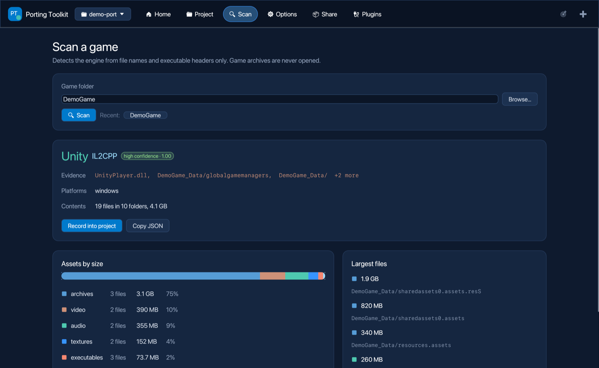
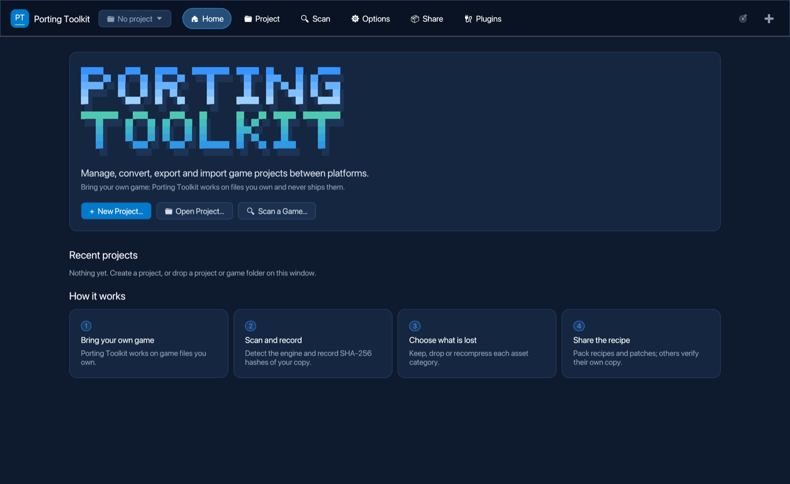
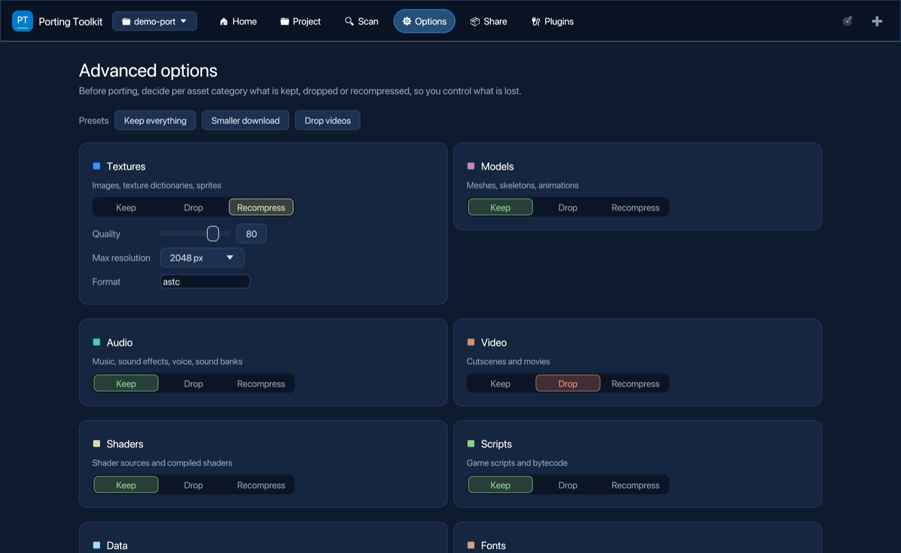
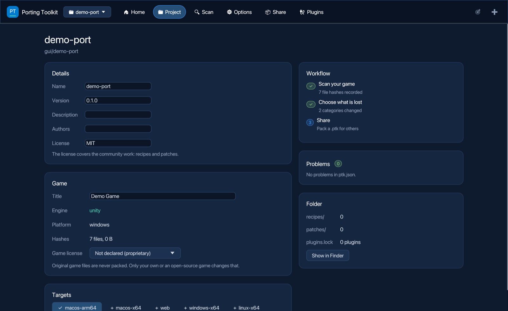
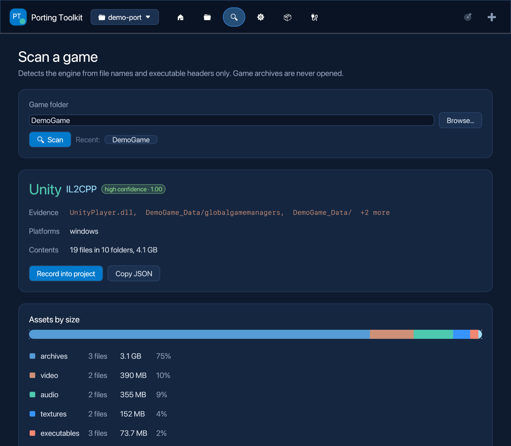

# Porting Toolkit

```
██████      ████    ██████    ██████████  ██████  ██      ██    ██████
██░░░░██  ██ ░░░██  ██░░░░██   ░░░██░░░░░  ░██░░░ ████    ██░ ██ ░░░░░░
██████ ░░ ██░   ██░ ██████ ░░     ██░       ██░   ██░░██  ██░ ██░ ████
██░░░░░   ██░   ██░ ██░░██░       ██░       ██░   ██░  ░████░ ██░  ░██░
██░        ░████ ░░ ██░  ░██      ██░     ██████  ██░    ░██░  ░██████░
 ░░          ░░░░    ░░    ░░      ░░      ░░░░░░  ░░      ░░    ░░░░░░
██████████    ████      ████    ██        ██    ██  ██████  ██████████
 ░░░██░░░░░ ██ ░░░██  ██ ░░░██  ██░       ██░ ██ ░░  ░██░░░  ░░░██░░░░░
    ██░     ██░   ██░ ██░   ██░ ██░       ████ ░░     ██░       ██░
    ██░     ██░   ██░ ██░   ██░ ██░       ██░░██      ██░       ██░
    ██░      ░████ ░░  ░████ ░░ ████████  ██░  ░██  ██████      ██░
     ░░        ░░░░      ░░░░    ░░░░░░░░  ░░    ░░  ░░░░░░      ░░
```

A community tool to manage, convert, export and import game projects between
platforms. macOS first; Windows and Linux later.

**Bring your own game.** Porting Toolkit works on game files you own. Community
project files (`.ptk`) share recipes, settings, community-written patches and
SHA-256 hashes, never original game files or decompiled game code. See
[docs/legal.md](docs/legal.md).


> Status: **phase 2** (CLI + desktop GUI). Detection, project files, advanced
> options, packing, verifying and plugin validation work. Converting and
> exporting arrive with plugins in phase 3.

## Install from source (macOS)

You need the Xcode Command Line Tools, [rustup](https://rustup.rs) and
[uv](https://docs.astral.sh/uv/).

```bash
git clone https://github.com/Hallel133/Porting-Toolkit.git
cd Porting-Toolkit
cargo build --release
./target/release/ptk doctor     # checks tools, sets up the Python engine
```

`ptk doctor` creates a managed Python environment for the engine in
`~/Library/Application Support/PortingToolkit/`.

## Quick start

```bash
ptk                                   # banner + help
ptk init my-port --title "My Game"    # new project folder
ptk scan ~/Games/MyGame --record my-port
ptk options set textures --action recompress --quality 80 --max-resolution 2048 -p my-port
ptk info my-port                      # game, targets, advanced options
ptk pack my-port                      # -> my-port-0.1.0.ptk (no game files inside)
```

Someone else continues the port with their own copy of the game:

```bash
ptk unpack my-port-0.1.0.ptk
ptk verify ~/Games/MyGame -p my-port  # is this the same game version?
```

## Desktop app

`ptk-gui` is the desktop app: a header with the project switcher and
navigation (Home, Project, Scan, Options, Share, Plugins, plus Targets and
Doctor), and pages of cards that reflow to the window width. On macOS it has
a real menu bar (File, Edit, View, Tools, Window, Help) with the usual
shortcuts: ⌘N new project, ⌘O open, ⌘S save, ⇧⌘E pack, ⇧⌘G scan a game,
⌘R scan again, ⌘1–⌘7 switch pages. You can also drop a project folder, a
`.ptk` file or a game folder on the window.

```bash
cargo run --release -p ptk-gui
```



| | |
|---|---|
|  |  |
|  |  |

## Commands

| Command | What it does |
|---|---|
| `ptk`, `ptk about` | Banner, help, version, roadmap |
| `ptk init <dir>` | New project: `ptk.json`, `recipes/`, `patches/`, `plugins.lock` |
| `ptk info [project]` | Project, `ptk.json` or `.ptk`: game, targets, advanced options |
| `ptk options [set …]` | Keep / drop / recompress, quality, max resolution per asset category |
| `ptk targets` | Platforms (web, macos-arm64, macos-x64, windows-x64, linux-x64, + SDK targets) |
| `ptk doctor` | Checks Xcode CLT, clang, rustup, uv; sets up the engine |
| `ptk scan <game-dir>` | Engine and contents from file names only (`--json`, `--record`) |
| `ptk pack` / `ptk unpack` | Create / check-and-extract a `.ptk` community project file |
| `ptk verify <game-dir>` | Compare your game files with a project's recorded hashes |
| `ptk plugin list\|new\|validate\|install` | Import/export plugins (format only in phase 1) |

`ptk scan` recognises Unity, Unreal, Godot, RAGE, Source, GameMaker, Ren'Py,
RPG Maker (MV/MZ/VX/VX Ace/XP) and macOS `.app` / Mach-O, from names and
executable headers only. It never opens or decodes game archives.

Colors are off when output is not a terminal, with `NO_COLOR=1` or `--no-color`.

## Roadmap

1. macOS + CLI infrastructure + banner + file structure (done)
2. **Desktop GUI (egui)** (now)
3. Import/export plugins and smart, AI-assisted advanced options
4. Windows/Linux and the full community marketplace

## Documentation

- [ARCHITECTURE.md](ARCHITECTURE.md): Rust app + Python engine, JSON-RPC protocol
- [docs/project-format.md](docs/project-format.md): `ptk.json` and `.ptk` files
- [docs/plugins.md](docs/plugins.md): plugin format and security model
- [docs/legal.md](docs/legal.md): why the toolkit never distributes games

## Development

```bash
cargo test --workspace                # Rust (also starts the Python engine)
(cd engine && uv run pytest)          # Python engine
cargo fmt --all --check && cargo clippy --workspace --all-targets -- -D warnings
```

## License

MIT. See [LICENSE](LICENSE).

---

<div dir="rtl">

## עברית

**Porting Toolkit** הוא כלי קהילתי לניהול, המרה, ייצוא וייבוא של פרויקטי משחקים בין פלטפורמות. קודם macOS, ואחר כך Windows ו-Linux.

**מביאים את המשחק שלכם.** הכלי עובד על קבצי משחק שבבעלותכם. קובצי פרויקט קהילתיים (`.ptk`) משתפים מתכונים, הגדרות, תיקונים שהקהילה כתבה וטביעות SHA-256 בלבד, **אף פעם** לא קבצי משחק מקוריים או קוד משחק מפורק. הפקודה `ptk pack` מסרבת לארוז קבצים של צד שלישי, ו-`ptk verify` בודקת שהעותק שלכם תואם לגרסה שהפרויקט נבנה עבורה.

### התקנה (macOS)

צריך Xcode Command Line Tools,‏ rustup ו-uv. אחרי `cargo build --release` מריצים `ptk doctor`, שבודק את הכלים ומקים סביבת Python מנוהלת למנוע בתיקייה `~/Library/Application Support/PortingToolkit/`.

### שימוש בסיסי

- `ptk init my-port` יוצר פרויקט חדש.
- `ptk scan <תיקיית משחק> --record my-port` מזהה את המנוע (Unity,‏ Unreal,‏ Godot,‏ RAGE,‏ Source,‏ GameMaker,‏ Ren'Py,‏ RPG Maker,‏ macOS) לפי שמות קבצים בלבד, ושומר טביעות.
- `ptk options set textures --action recompress --quality 80` קובע מה נשמר, נמחק או נדחס מחדש לפני ההמרה.
- `ptk pack` / `ptk unpack` / `ptk verify` לשיתוף פרויקטים.
- `ptk plugin new|validate|install|list` לתוספי ייבוא/ייצוא (ב-Python, עם הצהרת הרשאות).

### אפליקציה גרפית

`ptk-gui` היא אפליקציית דסקטופ בגוונים של כחול כהה: כותרת עם בורר פרויקטים וניווט, ודפים של כרטיסים שמתאימים את עצמם לרוחב החלון. ב-macOS יש לה menu bar אמיתי (File, Edit, View, Tools, Window, Help) עם קיצורי מקלדת (⌘N, ⌘O, ⌘S, ⌘1–⌘7 ועוד). היא עושה כל מה שה-CLI עושה, ואפשר לגרור אליה תיקיית פרויקט, קובץ `.ptk` או תיקיית משחק. הפעלה: `cargo run --release -p ptk-gui`.

### מפת דרכים

1. ‏macOS + תשתית CLI + באנר + מבנה קבצים (הושלם)
2. ממשק גרפי (עכשיו)
3. תוספי ייבוא/ייצוא ואפשרויות מתקדמות חכמות (בעזרת AI)
4. ‏Windows/Linux וקהילה מלאה

רישיון: MIT.

</div>
